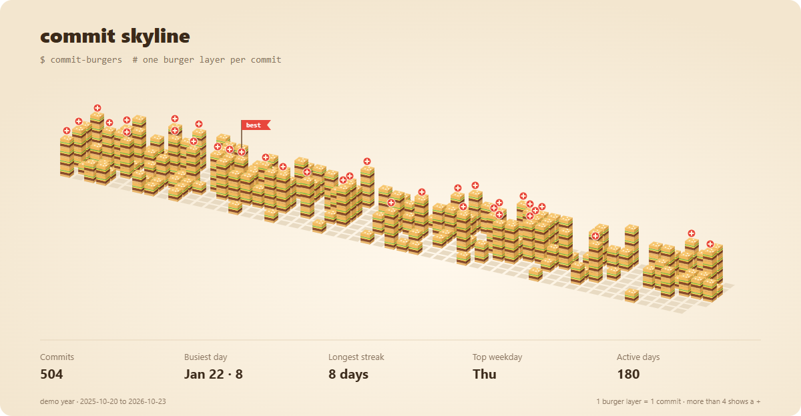
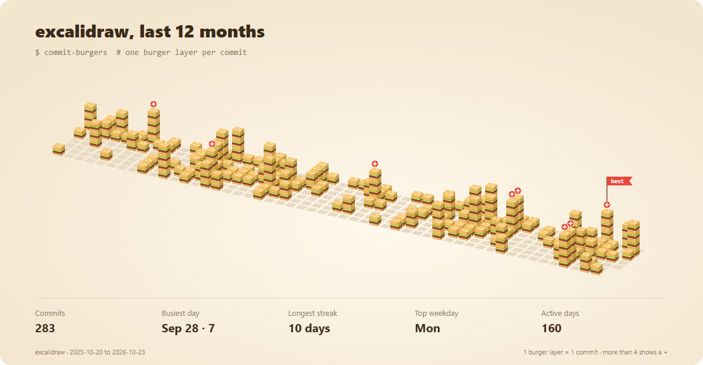
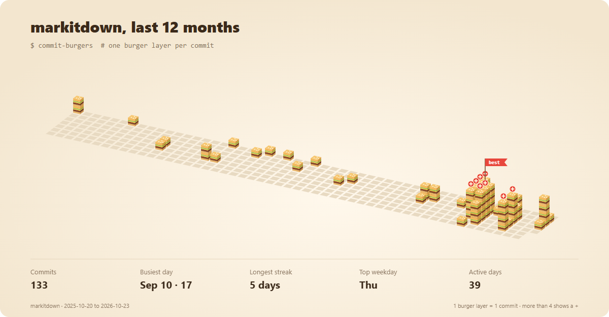
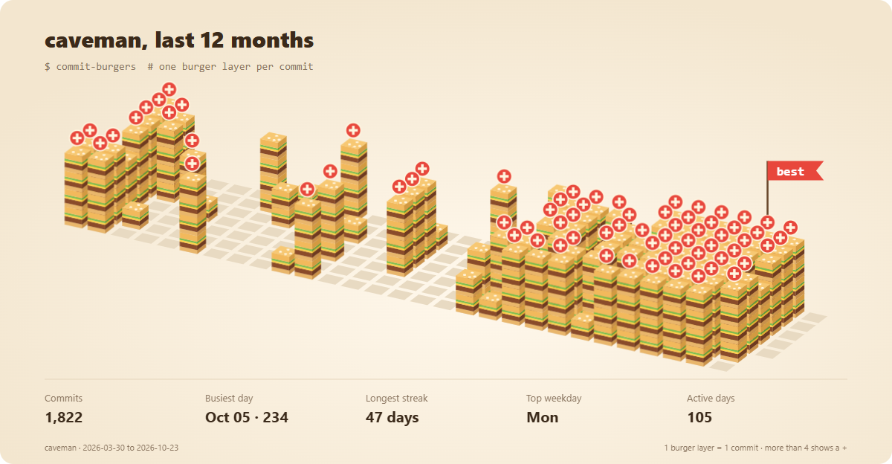
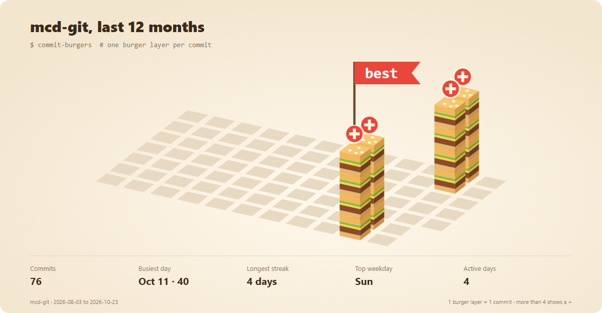

<div align="center">

# commit-burgers

**Turn a year of git commits into a 3D burger skyline and a marimba song.**

The burger skyline from [mcd-git](https://github.com/zhutoumeme/mcd-git) (McDonald's orders as git commands) meets the sound engine of [earshot](https://github.com/Leonxlnx/earshot) (ears for coding agents), pointed at your own `git log`.

 

Works with **Claude Code** and **Codex**.



</div>

Every image on this page is a real `python commit_burgers.py` run, screenshotted with headless Chrome. The demo year is synthetic; the gallery below uses real public repositories.

## Quick start
```bash
git clone https://github.com/Dodai0419/commit-burgers && cd commit-burgers && pip install numpy
python commit_burgers.py ~/code/my-project -o out
```
```text
commit-burgers: 504 commits over 53 weeks in demo year
  busiest day Jan 22 · 8, longest streak 8 days, top weekday Thu
  wrote out/skyline.svg (40.4 KB), out/song.wav (11.6 s), out/index.html
```
No repo at hand? `python commit_burgers.py --demo -o out` draws the synthetic year above.

You get three files:

| File | What it is |
|------|------------|
| `skyline.svg` | The picture. Burgers drop in week by week once on load (pure CSS, under 3 s), then stay. Light and dark themes follow the viewer's system. Paste it into your profile README. |
| `song.wav` | Your year as music: one marimba note per active week, higher for busier weeks, a glockenspiel over the busiest one, walking from left to right in stereo. |
| `index.html` | The skyline and a **Play the year** button: burgers drop in time with the notes. |

## The problem
- GitHub's contribution graph is a flat grid of green squares; nobody screenshots it to share.
- "Year in review" tools need an account, an API token or a web service that reads your private repos.
- Your history lives in `git log`, which already has every date you need, offline.

## The solution
| Idea | Fixes |
|------|-------|
| **One burger layer per commit, per day** (mcd-git's isometric skyline) | A recap people actually want to look at: tall stacks are crunch days, empty tiles are holidays |
| **One note per week** (earshot's struck-bar marimba) | You can *hear* your rhythm: steady weeks hum along, a release week rings out on top |
| **Reads `git log` only** | Works on any repo, private or not, with no token, no network and no account |
| **Animated SVG, no JS** | Drops straight into a GitHub README and plays there |

## Gallery

Real repositories, last 12 months of commits on their default branch (cloned 2026-10-23).

**excalidraw/excalidraw**: steady, Monday-heavy, a 10-day streak.



**microsoft/markitdown**: quiet most of the year, then one 17-commit day.



**JuliusBrussee/caveman**: 1,822 commits in 30 weeks, a 47-day streak, and a red "+" on most days of the last two months (234 commits on Oct 5).



**zhutoumeme/mcd-git** itself: a young repo, so the grid is scaled up to fill the card (at least 12 weeks are shown).



## Options
```bash
python commit_burgers.py REPO --author "Ada"          # only your commits (git log --author)
python commit_burgers.py REPO --since 2026-01-01      # any git log --since value
python commit_burgers.py REPO --title "my 2026"       # card title
python commit_burgers.py REPO --step 0.3              # slower song: 0.3 s per week
```

How the picture is built:
- 53 Monday-first week columns ending with today's week; days in the future are left out.
- A day with commits gets 1 to 4 burger layers (bun, patty, cheese, lettuce, bun) and a sesame top; more than 4 adds a red "+".
- The busiest day gets a "best" flag. Days without commits are dark floor tiles.
- Stats: total commits, busiest day, longest streak of consecutive days, top weekday, active days.

How the song is built:
- Weeks with at least one commit get a note, ranked from quietest to busiest onto two octaves of the major pentatonic, starting at G3.
- Notes are earshot's marimba (a struck bar with partials at 1 : 3.92 : 9.8, a damper at 62 ms), panned from left (oldest week) to right (newest).
- The busiest week adds earshot's octave-doubled glockenspiel two octaves up. The mix is normalized to -1 dBFS.

## Use with Claude Code
```bash
/plugin marketplace add Dodai0419/commit-burgers
/plugin install commit-burgers@commit-burgers
```
Then ask: "draw my commit skyline for this repo and make the song".

## Use with Codex (ChatGPT)
```bash
git clone https://github.com/Dodai0419/commit-burgers && cp -r commit-burgers/skills/* ~/.codex/skills/
```
Or copy `AGENTS.md` into your project root.

## Same output as upstream
- **Skyline:** for the same per-day counts, every floor tile, burger layer, sesame top, "+" and flag lands on exactly the same coordinates as `mcd_git.card_skyline.render_svg`, including the scale-to-fit transform for short histories (`tests/fixtures/skyline_*.json`, made from upstream by `bench/make_fixtures.py`). Labels are English and the stats are about commits instead of orders.
- **Notes:** `voice()` returns the same samples as earshot's `mallet._voice` for the same parameters and seed (max difference under 2e-6 over three notes, `tests/fixtures/earshot_notes.json`). Left out on purpose: the mallet's contact noise and the room reverb, which need scipy.

## Benchmarks
Windows 11, Python 3.11.1, numpy 2.4 / scipy in the same venv, mcd-git `cb1601d`, earshot `591fa3e`. `python bench/bench.py path/to/mcd-git path/to/earshot`, median of 30 (skyline) or 10 (notes) runs, upstream and this repo run alternately; three runs of the script:

| | upstream | this repo |
|-|-|-|
| render the 53-week skyline SVG | 3.0 / 4.1 / 4.4 ms | 4.1 / 5.7 / 5.8 ms |
| synthesize 49 marimba notes | 271 / 280 / 293 ms | 272 / 283 / 296 ms |
| import time (new process) | 4,777 / 4,696 / 5,762 ms | 430 / 538 / 477 ms |
| lines of code | 257 (`card_skyline.py`) + 272 (`mallet.py`), plus their helpers | 359 for both, plus git reading, the song mix, WAV and page |
| runtime dependencies | mcd-git: rich, qrcode; earshot: numpy, scipy, soundfile, soxr, librosa, pyloudnorm, scikit-learn, pillow, matplotlib | numpy |

Rendering is not faster: the skyline is about 1 ms slower (it also computes the stats) and the notes use the same math. The win is start-up: about 10x less import time, because nothing pulls in scipy or rich. A whole `--demo` run (skyline, song and page) took 0.74 s here.

## Inspired by
- [zhutoumeme/mcd-git](https://github.com/zhutoumeme/mcd-git) — the isometric burger skyline card (`git mcd card`), its geometry and drop animation.
- [Leonxlnx/earshot](https://github.com/Leonxlnx/earshot) — the marimba and glockenspiel notes, written in code from its study of launch-film sounds.

## Roadmap
- [ ] `--gh USER`: read the GitHub contribution calendar instead of one repo.
- [ ] Export the page as an MP4 with sound for social posts.
- [ ] More instruments from earshot's bank (pluck, celesta) chosen by commit type.

## License
MIT. Includes MIT-licensed code from mcd-git and earshot; see NOTICE.
